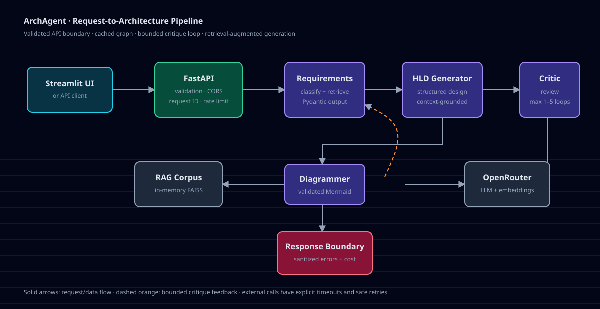
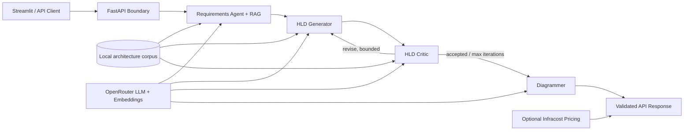

# ArchAgent

[](https://github.com/AkshatSharma25/ArchAgent/actions/workflows/ci.yml)
[](https://www.python.org/)
[](LICENSE)

**ArchAgent turns a plain-language product idea into validated requirements, a reviewed high-level design, and a Mermaid architecture diagram.**

It is intended for software engineers, technical founders, students, and architects who want a structured first design—not an unreviewed chat response. ArchAgent is an engineering prototype, not a production-ready architecture authority.

## Demo

**Sample prompt**

> Design a multi-tenant document-management system for 10,000 users with versioning, full-text search, role-based access, audit logs, and 99.9% availability.

Checked-in artifacts:

- [Request](examples/sample-request.json)
- [Illustrative response fixture](examples/sample-response.json) — explicitly hand-authored; it is not presented as a live model result
- [Architecture diagram](docs/architecture.svg)

A short live demonstration video is not published yet. The [recording checklist](docs/demo-recording.md) defines a reproducible two-minute demo and prevents edited output from being mistaken for a live run.

## Problem

System-design prompts commonly produce prose that is inconsistent, difficult to validate, and disconnected from workload requirements. ArchAgent separates the work into explicit stages, validates structured outputs with Pydantic, retrieves relevant design guidance, and applies a bounded critic loop before generating Mermaid.

## Features

- Requirements classification and workload extraction
- Retrieval-augmented generation (RAG) over local architecture references
- Structured HLD generation with Pydantic validation
- Bounded generate → critique → revise loop (1–5 iterations)
- Mermaid normalization and safety validation
- Optional AWS price lookup through Infracost
- FastAPI contracts with request IDs and structured errors
- Configurable CORS, prompt limits, rate limiting, and outbound timeouts
- Health (`/health`) and readiness (`/ready`) probes
- Offline tests that make no paid model calls
- Pinned Python dependencies and digest-pinned container base image

## System Architecture





The compiled top-level graph is cached at application scope. Agent and retrieval initialization is also cached, so requests do not rebuild the complete graph or load unsafe pickle-backed indexes.

## Agent Workflow

1. **Requirements agent** identifies the product archetype, workload metrics, functional requirements, non-functional requirements, and technical taxonomy.
2. **HLD generator** combines those requirements with retrieved architecture context and returns a schema-valid design.
3. **HLD critic** checks integrity, request flow, infrastructure, security, and bottlenecks.
4. **Revision loop** feeds criticism back to the generator until the configured maximum is reached. The default is 3 and the allowed range is 1–5.
5. **Diagrammer** converts the validated design into Mermaid and rejects unsafe or malformed output.
6. **Pricing adapter** optionally estimates mapped AWS components. Unsupported components are omitted rather than assigned invented prices.

### Why RAG?

General models can omit workload-specific constraints or produce generic designs. Retrieval supplies architecture patterns from the repository corpus at each reasoning stage. It improves grounding, but it does **not** guarantee correctness: corpus quality, retrieval relevance, and model behavior still matter.

## Technology Stack

| Layer | Technology |
|---|---|
| API | FastAPI, Pydantic Settings, Uvicorn |
| Workflow | LangGraph |
| LLM integration | LangChain + OpenRouter-compatible API |
| Retrieval | FAISS built in memory from checked-in text sources |
| UI | Streamlit |
| Quality | pytest, Ruff, mypy, Bandit, pip-audit, Gitleaks |
| Packaging | `pyproject.toml`, compiled requirements, Docker Compose |

## Quick Start

### Docker Compose (recommended)

Prerequisites: Docker with Compose.

```bash
git clone https://github.com/AkshatSharma25/ArchAgent.git
cd ArchAgent
cp .env.example .env
# Add OPENROUTER_API_KEY to .env
docker compose up --build
```

Open:

- UI: <http://localhost:8501>
- API docs: <http://localhost:8000/docs>
- Liveness: <http://localhost:8000/health>
- Readiness: <http://localhost:8000/ready>

### Native Python

Supported Python versions: **3.11 and 3.12**.

```bash
python -m venv .venv
# Linux/macOS
. .venv/bin/activate
# Windows Git Bash
. .venv/Scripts/activate
python -m pip install --requirement requirements-dev.txt
cp .env.example .env
uvicorn backend.app:app --host 127.0.0.1 --port 8000
```

In another terminal:

```bash
BACKEND_URL=http://localhost:8000/chat streamlit run ui/app.py
```

Production containers use two Uvicorn workers rather than FastAPI's development server.

## Environment Variables

| Variable | Required | Default | Purpose |
|---|---:|---|---|
| `OPENROUTER_API_KEY` | Yes | — | LLM and embedding provider authentication |
| `INFRACOST_API_KEY` | No | — | Optional AWS price lookup |
| `OPENROUTER_MODEL` | No | `meta-llama/llama-3.3-70b-instruct:free` | Chat model identifier |
| `OPENROUTER_EMBEDDING_MODEL` | No | `openai/text-embedding-3-small` | Embedding model identifier |
| `CORS_ORIGINS` | No | `["http://localhost:8501"]` | JSON array of allowed origins |
| `MAX_PROMPT_CHARS` | No | `10000` | Maximum input length |
| `CRITIC_MAX_ITERATIONS` | No | `3` | Critique bound, from 1 to 5 |
| `RATE_LIMIT_PER_MINUTE` | No | `0` | Per-client in-memory limit; `0` disables it |
| `EXTERNAL_TIMEOUT_SECONDS` | No | `15` | Outbound pricing timeout |

Never commit `.env`. If a credential has ever been committed, removing it from the latest source is insufficient: revoke it at the provider and purge the affected Git history.

## API Reference

### `POST /chat`

```json
{
  "user_input": "Design a real-time chat platform for 50,000 concurrent users",
  "thread_id": "optional-client-thread-id"
}
```

The response contains:

- `request_id` and `thread_id`
- `output_requirements` as Markdown
- `output_design` as Markdown
- `output_code` as validated Mermaid
- `critique_iterations`
- optional monthly cost estimate and itemized notes

Errors use a stable envelope:

```json
{
  "error": {
    "code": "prompt_too_large",
    "message": "user_input exceeds the configured limit",
    "request_id": "..."
  }
}
```

### Operations endpoints

- `GET /health`: process liveness; does not require provider credentials
- `GET /ready`: returns `200` only when required configuration is present

## Evaluation

The evaluation corpus includes six product types: e-commerce, real-time chat, document management, AI support, analytics, and multi-tenant SaaS.

Run the zero-cost contract evaluation:

```bash
python -m evaluation.run_offline
```

Current checked-in result: **6/6 schema-valid, 6/6 Mermaid-valid, and 100% required-section coverage** in deterministic fixture mode. This validates contracts and evaluation plumbing only. It performs zero live model calls and must not be interpreted as a model-quality, latency, consistency, or cost benchmark. See [`evaluation/results/offline-contract.json`](evaluation/results/offline-contract.json).

A credible live benchmark must record commit SHA, corpus checksum, model IDs, prompt version, retrieval `k`, temperature, per-stage latency, token use, provider cost, critique count, failures, repeated-run consistency, and human completeness ratings. No unsupported live-quality claim is made here.

## Reliability, Latency, and Cost

- **Reliability:** API schemas, routing, loop bounds, Mermaid checks, retrieval behavior, pricing arithmetic, timeout behavior, and error contracts are tested offline.
- **Latency:** no representative live p50/p95 result is published yet. Runtime depends on provider queueing, four agent stages, retrieval initialization, and critique count.
- **LLM cost:** depends on the selected OpenRouter models and token volume. The default chat model identifier currently uses a free route, but availability and provider pricing can change.
- **Infrastructure estimate:** optional and approximate. It uses a small explicit SKU map, 730 hours/month, and 10 million requests for request-priced services. It is not a cloud bill forecast.

## Testing

```bash
pytest
ruff format --check backend src ui tests evaluation
ruff check backend src ui tests evaluation
mypy backend
bandit -q -r backend src
pip-audit -r requirements.txt
```

The default suite injects fake architecture and pricing services, so `pytest` makes no OpenRouter, Infracost, or paid external calls.

## Security

- Credentials are read from environment variables and excluded from logs and representations.
- CORS is allowlisted instead of wildcarded.
- Prompts and generated state are not logged.
- External pricing calls have explicit timeouts and only safe transport retries should be added.
- Generated pickle-backed FAISS artifacts are not trusted or loaded from Git.
- Gitleaks and dependency scans run in CI.

> **Credential incident response:** any previously committed Infracost key must be considered compromised and revoked or rotated in the Infracost account. History cleanup does not revoke a credential.

## Known Limitations

- Generated designs can be incomplete, internally inconsistent, or unsuitable for a real workload.
- The local reference corpus is small and has no formal source/version quality score.
- The in-memory FAISS indexes are rebuilt per worker process and increase cold-start time.
- The rate limiter is process-local; public multi-instance deployment needs a shared gateway or store.
- There is no authentication, authorization, persistent job queue, cancellation, or tenant isolation in the API.
- Live model evaluation, human ratings, p50/p95 latency, repeated-run consistency, and provider cost measurements are not yet published.
- Infracost coverage is intentionally limited to explicitly mapped AWS technologies.
- A public live instance and demonstration video are not yet available.

## Roadmap

- [ ] Publish a reproducible live-model benchmark with human ratings
- [ ] Add corpus provenance, checksums, and retrieval relevance metrics
- [ ] Add authentication and a distributed rate limiter before public deployment
- [ ] Move long-running generation to cancellable background jobs
- [ ] Publish a short unedited demo and versioned GitHub release
- [ ] Add OpenTelemetry traces without prompt or generated-state leakage

## Repository Layout

```text
backend/          FastAPI boundary, configuration, services, and schemas
src/              agents, LangGraph workflows, prompts, and domain models
ui/               Streamlit client
tests/            deterministic offline tests
evaluation/       six-case evaluation dataset and contract runner
examples/         sample API request and illustrative response
docs/             architecture and demo guidance
.github/workflows CI and security automation
```

## License

[MIT](LICENSE)
